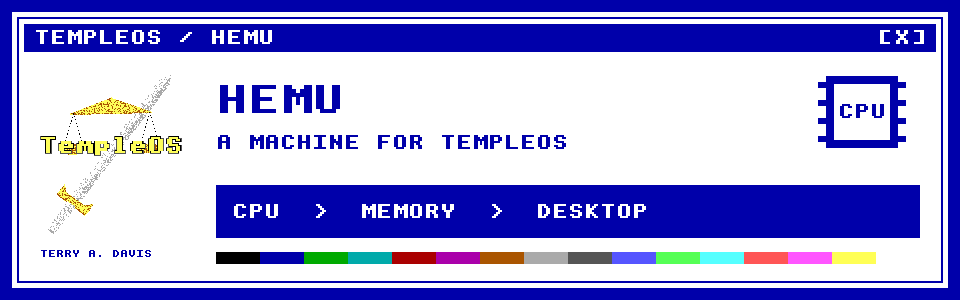

<p align="center">
  
</p>

# HEMU

**A TempleOS machine for the browser and Linux.** Resume the V5.03 desktop through a HolyC x86-64 emulator or a native KVM host.

**[Try it in TempleOS-Web →](https://templeosweb.netlify.app/)**

---

<details>
<summary><b>Run in a browser</b></summary>

<br>

With Node.js and npm installed, run from this checkout:

```sh
while read dir url sha; do git clone -q "$url" "$dir" && git -C "$dir" checkout -q "$sha"; done <Siblings.txt
npm install
node Kernel/Build.mjs
node Misc/Server.mjs
```

Open the local URL printed by the server. This standalone desktop uses the same engine as TempleOS-Web, with automatic C: storage in the browser.

[Browser runtime](Kernel/README.md)

</details>

---

<details>
<summary><b>Run on Linux</b></summary>

<br>

The native host needs x86-64 Linux, KVM, Wayland, a C compiler, Python 3 and ALSA development headers.

```sh
Linux/make_hemu
```

This **builds and installs** HEMU under `~/.local/share/HEMU`, adds a TempleOS launcher and, under Hyprland, installs **Super+Alt+T**. Disk writes in this Linux host are discarded when it exits.

[Installation, removal and native host details](Doc/Guide.md#linux)

</details>

---

<details>
<summary><b>Machine and limits</b></summary>

<br>

The captured desktop already contains the Welcome card, Take Tour question and native display corrections. HEMU restores matching RAM, registers and disk sectors; it does not run the DVD's 16-bit BIOS loader.

The browser engine combines a HolyC CPU/device interpreter, an x86-to-WASM JIT and source-derived graphics acceleration. It implements the hardware and instructions used by the supported TempleOS workloads, not a general PC.

[Architecture and supported behavior](Doc/Guide.md) · [Capture recipe](Misc/Capture/README.md)

</details>

---

<details>
<summary><b>Development and credits</b></summary>

<br>

```sh
node Kernel/Test/Chk.mjs
```

[Checks and coverage](Kernel/Test/README.md) · [Host interface](Kernel/Host.HC) · [HolyC-wasm compiler](https://github.com/ParkerrDev/HolyC-wasm)

TempleOS, HolyC, the sword-and-scales artwork and the 8×8 system font were created by **Terry A. Davis**. TempleOS is public domain. The banner uses its font and artwork.

</details>
